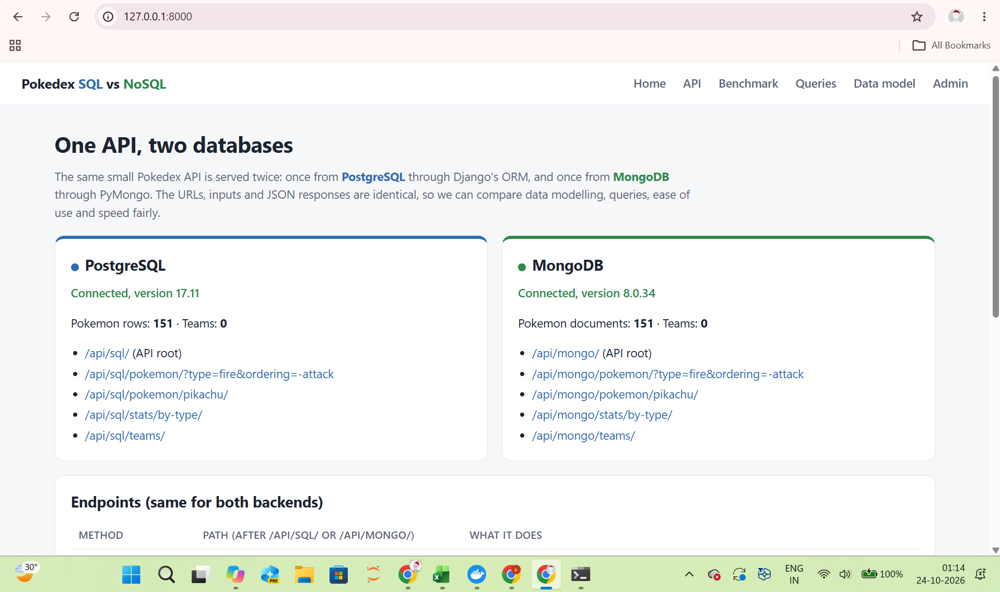
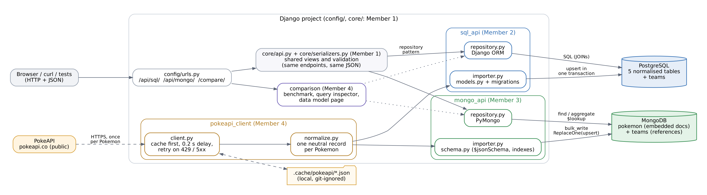
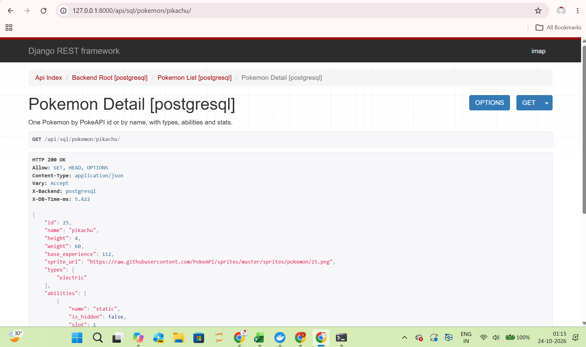
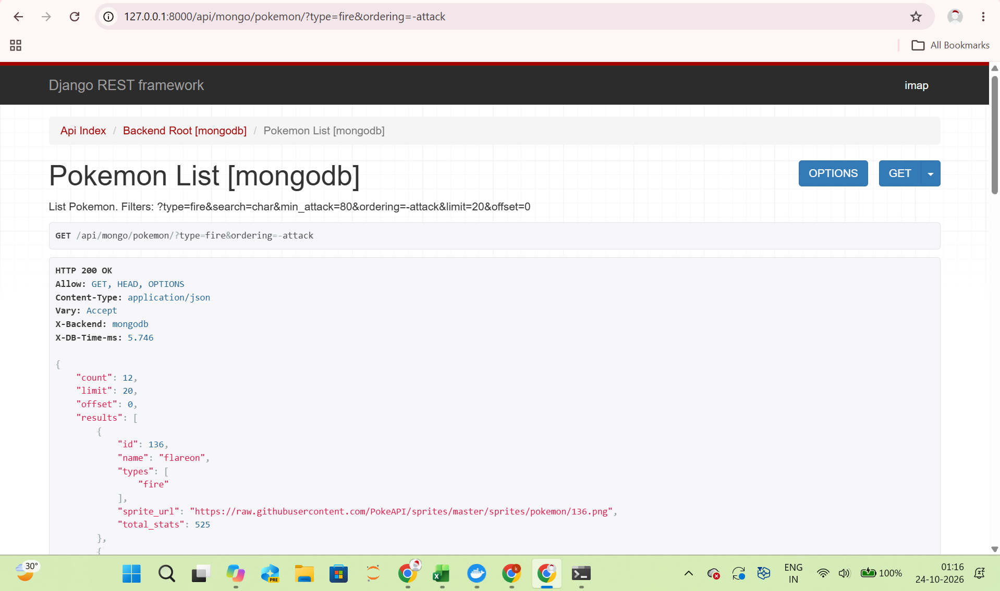
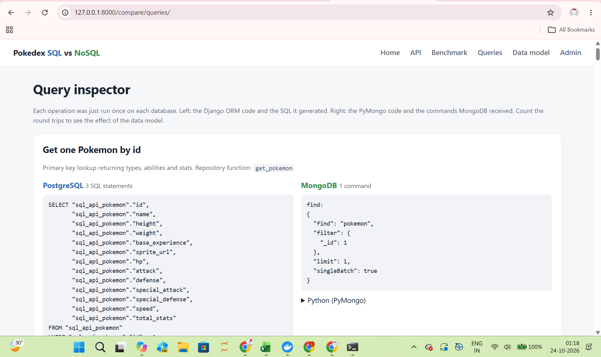
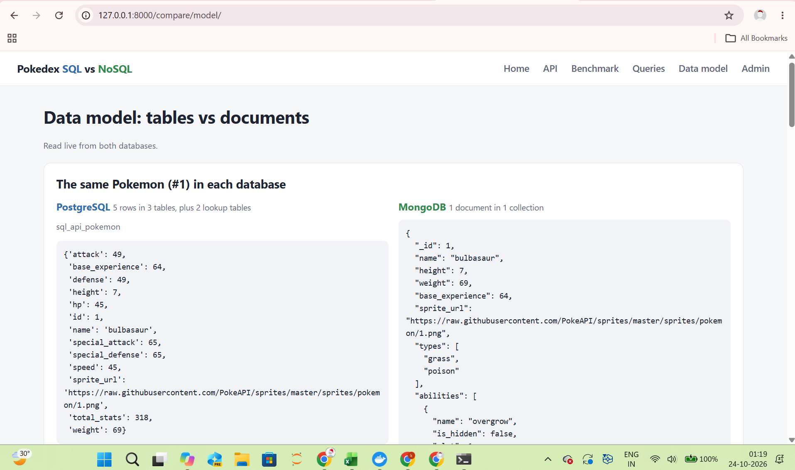
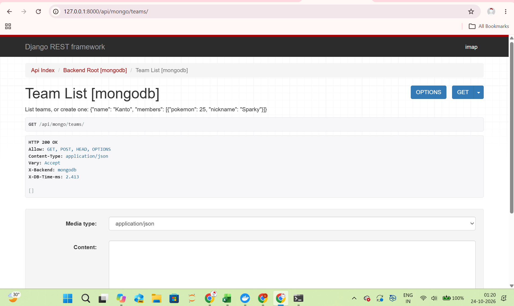
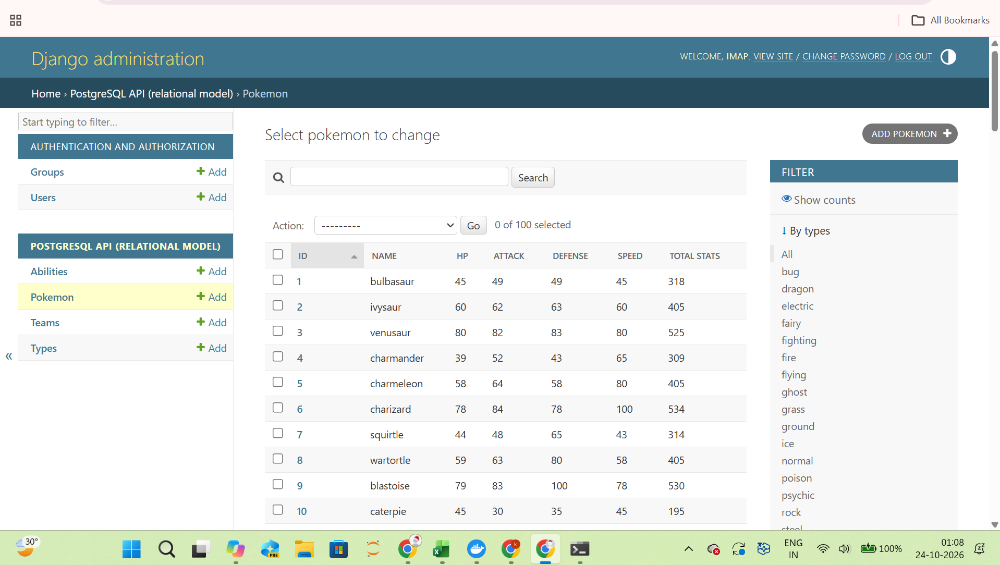
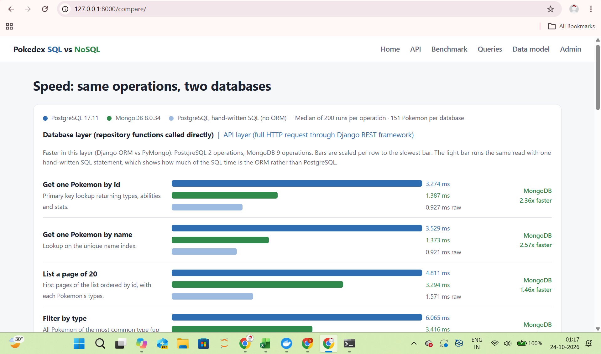

# SQL vs NoSQL in Django: one Pokedex API, two databases

**Topic 18: SQL vs NoSQL in Django.** We built the same small REST API twice, once on
**PostgreSQL** (through Django's ORM) and once on **MongoDB** (through PyMongo), using
Pokemon data from [PokeAPI](https://pokeapi.co/). The two versions have identical URLs,
inputs and JSON responses, so we could compare **data modelling, queries, ease of use and speed**
on equal terms.



## Team members and roles

<!-- section:team start -->
| Member | Role | Main parts of the code |
|---|---|---|
| Mahek Shah (Member 1) | Project lead, DevOps, shared API layer | `config/`, `core/`, `docker-compose.yml`, CI, README |
| Kritika (Member 2) | PostgreSQL lead | `sql_api/` (models, migration, importer, ORM repository, raw SQL) |
| Oqba (Member 3) | MongoDB lead | `mongo_api/` (document schema, validators, importer, PyMongo repository) |
| Muskaan (Member 4) | Data and benchmarking lead | `pokeapi_client/` (PokeAPI + cache), `comparison/` (benchmark, dashboard) |
<!-- section:team end -->

## What the project does

* Downloads Pokemon from PokeAPI **once**, caches every response on disk, waits between calls
  and backs off on HTTP 429, so the public API is never hammered.
* Turns each response into one neutral record and loads it into **both** databases.
* Serves the same API from both:

| Method | Path (after `/api/sql/` or `/api/mongo/`) | What it does |
|---|---|---|
| GET | `pokemon/?type=&search=&min_attack=&ordering=&limit=&offset=` | List with filters, sorting and paging |
| GET | `pokemon/<id or name>/` | One Pokemon with types, abilities and stats |
| GET | `types/` | Each type and how many Pokemon have it |
| GET | `stats/by-type/` | Average base stats per type (aggregation) |
| GET | `stats/top/?stat=attack&limit=10` | Highest values for one stat |
| GET, POST | `teams/` | List teams / create a team of up to 6 Pokemon |
| GET, PUT, DELETE | `teams/<id>/` | Read (with a join), replace or delete a team |

* Every response carries `X-Backend` and `X-DB-Time-ms` headers.
* `/compare/` shows the benchmark, `/compare/queries/` shows the exact SQL and MongoDB commands each
  operation sends, and `/compare/model/` shows the same Pokemon as table rows and as a document.

## Architecture



The key design choice is the **repository pattern**. `core/api.py` holds one set of views and
`core/serializers.py` one set of validation rules. Each backend app only provides a
`repository.py` with the same functions (`list_pokemon`, `get_pokemon`, `stats_by_type`,
`create_team`, ...). So the only code that differs between the two databases is the code we
want to compare. A shared test suite (`core/testing.py`) runs against both backends and a
parity test checks that both APIs return identical JSON.

```
pokedex-sql-vs-nosql/
├── config/            settings (read from .env), root URLs
├── core/              shared API views + validation, MongoDB connection, home page, test helpers
├── pokeapi_client/    PokeAPI client: cache, delay, retries; normaliser; fetch_pokemon command
├── sql_api/           PostgreSQL: models + migration, importer, ORM repository, raw SQL, admin
├── mongo_api/         MongoDB: $jsonSchema + indexes, importer, PyMongo repository
├── comparison/        benchmark, query inspector, data model page, run_benchmark command
├── benchmark_results/ latest.json (shown on /compare/), sample_scale20.json
├── docs/              architecture diagram, screenshots
├── docker-compose.yml PostgreSQL 17 + MongoDB 8.0
└── .github/workflows/ci.yml   tests on every push, with real PostgreSQL and MongoDB
```

## Setup

You need **Python 3.10+**, **Git** and **Docker Desktop** (or local installs of PostgreSQL and MongoDB).

```bash
git clone https://github.com/<owner>/pokedex-sql-vs-nosql.git
cd pokedex-sql-vs-nosql

# 1. Settings: copy the example file (never commit .env)
cp .env.example .env              # Windows: copy .env.example .env

# 2. Start both databases
docker compose up -d

# 3. Python environment
python -m venv .venv
source .venv/bin/activate         # Windows: .venv\Scripts\activate
pip install -r requirements.txt

# 4. Create the schema on both sides
python manage.py migrate          # PostgreSQL tables
python manage.py setup_mongo      # MongoDB collections, validators, indexes

# 5. Get data: downloads 151 Pokemon once (about a minute), later runs use the cache
python manage.py fetch_pokemon --limit 151
python manage.py import_sql --limit 151
python manage.py import_mongo --limit 151

# 6. Run
python manage.py runserver        # open http://127.0.0.1:8000/
```

Optional: `python manage.py createsuperuser` and open `/admin/` to browse the PostgreSQL data.

Tests and benchmark:

```bash
python manage.py test                                   # 67 tests, both databases must be running
python manage.py run_benchmark --iterations 200         # results appear on /compare/
python manage.py run_benchmark --iterations 200 --scale 20   # 20x more data, synthetic copies
```

Without Docker: install PostgreSQL and create a user and database called `pokedex` (password
`pokedex`), install MongoDB Community Server, or use a free MongoDB Atlas cluster and put its
connection string in `MONGO_URI` in `.env`.

### Rules we follow for the public API and secrets

* Every PokeAPI response is cached in `.cache/pokeapi/` and never requested twice.
* One request at a time with a 0.2 s pause, a clear User-Agent, and automatic back-off on 429/5xx.
* The benchmark **never** calls PokeAPI; it only reads our own databases.
* Passwords and keys live in `.env`, which is in `.gitignore`. Only `.env.example` is committed.
  PokeAPI needs no key.

## Screenshots

| | |
|---|---|
|  |  |
| Pikachu from `/api/sql/` (PostgreSQL) | Fire types from `/api/mongo/` (MongoDB), same JSON shape |
|  |  |
| Query inspector: 3 SQL statements vs 1 MongoDB `find` | Bulbasaur as 5 rows in 3 tables vs 1 document |
|  |  |
| A team read with `$lookup` (MongoDB) | Free Django admin for the PostgreSQL side |



## Comparison

### Data modelling

| | PostgreSQL (relational) | MongoDB (document) |
|---|---|---|
| One Pokemon | 1 row in `pokemon` + 1-2 rows in `pokemontype` + 1-3 rows in `pokemonability`, names in `type` / `ability` | 1 document with `types` array, `abilities` array and `stats` sub-document |
| Teams | `team` + `teammember` rows with foreign keys to `pokemon` | `teams` document with an array of `{slot, pokemon_id, nickname}` references |
| Schema | `models.py` + migration, enforced by the database | Optional `$jsonSchema` validator we added in `schema.py` |
| Integrity | Foreign keys (`PROTECT`), unique and check constraints | Application checks references; nothing stops a dangling `pokemon_id` |

### Queries

| Operation | PostgreSQL (Django ORM) | MongoDB (PyMongo) |
|---|---|---|
| Pokemon detail | `filter(id=...)` + `prefetch_related`: **3 SQL statements** | `find_one({"_id": ...})`: **1 command** |
| Filter by type | JOIN through `pokemontype` | `{"types": "fire"}` on a multikey index |
| Average stats per type | `values("type__name").annotate(Avg(...))` = `GROUP BY` | `$unwind` + `$group` pipeline |
| Team with its Pokemon | JOINs via `select_related` / `prefetch_related` | `$lookup` (left outer join) |
| Create + read + delete a team | 16 statements incl. `BEGIN`/`COMMIT` | 5 commands |

### Ease of use

| | PostgreSQL + Django | MongoDB + PyMongo |
|---|---|---|
| Fits Django | Built-in backend, ORM, migrations, admin, test database handled for us | Outside the ORM: own connection helper, own test database handling, no admin |
| Writing queries | Short Python, joins hidden; easy to cause extra queries without `prefetch_related` | Queries are plain dicts; aggregation pipelines are longer but explicit |
| Changing the structure | Needs a migration | Just write the new field; old documents keep the old shape |
| Lines of code (models/schema + repository + importer) | 304 | 303 |

### Speed

<!-- section:results start -->
*To be written by Member 4 (benchmark results).*
<!-- section:results end -->

## Research questions (our answers)

### 1. Relational vs document model?

In the relational model data lives in tables of rows with fixed columns. Each fact is stored once, and tables point to each other with foreign keys. In our project one Pokemon is spread over five tables and is put back together with JOINs when it is read. The database knows the schema and enforces it. 

In the document model data lives in collections of JSON-like documents. Data that is read together is stored together, so our Pokemon document already contains its types, abilities and stats. The main difference is when the data is shaped. A relational design is shaped for correctness and for any question someone might ask later. A document design is shaped in advance for the way the application reads it, at the cost of some duplication. 

### 2. What are joins and schemas, and how does MongoDB handle them?

A join combines rows from two tables by matching a key, for example pokemon.id with pokemontype.pokemon_id. A schema describes the data a database will accept: tables, columns, types and rules such as NOT NULL, UNIQUE and FOREIGN KEY. 

MongoDB handles joins in three ways. It avoids most of them by embedding related data, as we did with types and abilities. When references are needed it offers the $lookup stage, which works like a left outer join; we used it to read teams. The application can also run two queries and combine the results itself. MongoDB has no foreign keys, so nothing stops a team from pointing at a deleted Pokemon, and our code checks references before saving (MongoDB, Inc., n.d.-a). 

MongoDB's schema is flexible by default, which makes changes easy but mistakes easy too. Our $jsonSchema validator makes the server reject documents with missing or wrongly typed fields. Even with a validator, documents written before a change keep their old shape, so the application has to handle both. 

### 3. When to pick each

**Pick PostgreSQL (SQL) when:**

* the data has many relationships and they must stay correct (orders, payments, stock, our teams);
* you need transactions across several tables;
* you need flexible questions and reports: joins, GROUP BY, ad-hoc analysis;
* the structure is fairly stable;
* you use Django: the ORM, migrations, admin and test tools all assume a SQL database.

**Pick MongoDB (NoSQL) when:**

* each record is naturally one self-contained document that is read and written as a whole
  (product catalogues, user profiles, content, logs, API responses like PokeAPI's);
* records have different or quickly changing fields;
* reads and writes are simple but very frequent, and you may need to scale out across servers;
* the application mostly works with JSON and rarely needs joins.

**For our Pokedex** both worked. MongoDB fit the Pokemon detail page better (one document, one
read, fastest writes), while PostgreSQL fit the teams (a many-to-many relationship that must stay
valid) and the statistics (aggregations were faster once the data grew). Because this is a Django
project, PostgreSQL was also clearly easier to build, test and administer. If we had to ship it,
we would choose PostgreSQL, and if part of the data really were document-shaped we would first
try a `JSONB` column in PostgreSQL before adding a second database.


## References

* PokeAPI documentation and fair use policy: https://pokeapi.co/docs/v2
* MongoDB manual: data modelling, `$lookup`, schema validation: https://www.mongodb.com/docs/manual/
* Django documentation: models, queries, `prefetch_related`, migrations: https://docs.djangoproject.com/en/5.2/
* PyMongo documentation: https://pymongo.readthedocs.io/
* PostgreSQL documentation: https://www.postgresql.org/docs/
